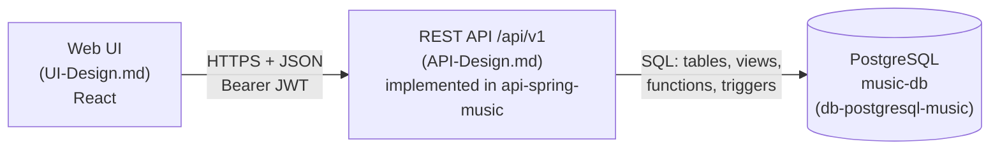

# design-music-system

**System design** for the music-db playlist platform. The platform is built on a PostgreSQL music catalog (artists, albums, songs, tracks, people, genres, labels) and the social layer around it (users, playlists, collaborators, libraries, follows). This repository covers two layers on top of that database:

1. **The REST API**: the HTTP interface to the database.
2. **The web UI**: the app people use to collect songs into playlists, share them, and keep five favorites on their profile.


This repository holds design only, with no implementation. Each layer has one source of truth: **[API-Design.md](API-Design.md)** for the API and **[UI-Design.md](UI-Design.md)** for the UI. This README is a summary and a way into both.

---

## Contents

- [What's in this repo](#whats-in-this-repo)
- [System overview](#system-overview)
- [UI at a glance](#ui-at-a-glance)
- [API design at a glance](#api-design-at-a-glance)
- [Resources](#resources)
- [Conventions](#conventions)
- [Access rules](#access-rules)
- [Errors](#errors)
- [Open items](#open-items)
- [Related material](#related-material)
- [Contributing](#contributing)

---

## What's in this repo

```
.
├── README.md              this overview
├── API-Design.md          API: the specification (source of truth)
├── REQUIREMENTS.md        API: every requirement from the design and the Spring implementation, with IDs
├── DB-Design.md           DB: schema changes for the UI and API (triggers, functions, views, migration order)
├── UI-Design.md           UI: screens, rules, wireframes, API mapping and gaps (source of truth)
└── ui/
    ├── UX-Research.md     UI: problem, personas, jobs to be done, user stories
    ├── User-Flows.md      UI: flow diagrams (sign up, add a song, favorite with the limit of 5…)
    ├── Design-System.md   UI: tokens, type, components, copy guidelines
    └── mockups/
        └── index.html     UI: clickable mockups of every v1 screen, two visual proposals
```

| File | Purpose |
|---|---|
| [API-Design.md](API-Design.md) | The complete API specification: conventions, every endpoint with request and response examples, the SQL behind each one, and how database errors map to HTTP. It includes the changes the web UI needs (favorites, visibility, limits, random picks, song search, login), marked **(UI)**. |
| [REQUIREMENTS.md](REQUIREMENTS.md) | Every API requirement, from this design and from the `api-spring-music` implementation, with an ID each and a list of where the two differ. |
| [DB-Design.md](DB-Design.md) | The database changes the UI and API need, with their SQL: the limits, visibility that follows favorites, random picks, song search, indexes, and the API-owned `auth` schema for JWT login. Written to be moved into the database project later. |
| [UI-Design.md](UI-Design.md) | The UI specification for v1: product rules, information architecture, every screen (wireframe, behavior, states, API calls), shared patterns, accessibility, and the API changes the UI needs. |
| [ui/UX-Research.md](ui/UX-Research.md) | Problem statement, personas, jobs to be done, user stories with acceptance criteria, success measures, assumptions to test. |
| [ui/User-Flows.md](ui/User-Flows.md) | Mermaid diagrams of the main flows, including limits and failures. |
| [ui/Design-System.md](ui/Design-System.md) | Color and type tokens for both visual proposals, components and their states, motion, copy guidelines. |
| [ui/mockups/index.html](ui/mockups/index.html) | Self-contained clickable mockups. Open the file in a browser; no build or install. |
| [README.md](README.md) | This overview. |

---

## System overview



| Layer | Designed in | Implemented in |
|---|---|---|
| Web UI | [UI-Design.md](UI-Design.md) and [ui/](ui/) | Not yet. It will be built in React. |
| REST API | [API-Design.md](API-Design.md), [REQUIREMENTS.md](REQUIREMENTS.md) | `api-spring-music` (Spring Boot) |
| Database | `data-model.md` in the database project; proposed changes in [DB-Design.md](DB-Design.md) | `db-postgresql-music` (the DB-Design.md changes aren't applied yet) |

---

## UI at a glance

**The product:** an unlimited catalog of songs that you search or browse, and collect into playlists. Playlists are private until someone favorites them. Your favorites, your own playlists and other people's, appear on your profile A–Z. A playlist stays public while anyone has it as a favorite, so others can open, share and favorite it.

| Rule | Limit |
|---|---|
| Favorite playlists per person (own and others' combined) | **5** |
| Songs per playlist | **100** |
| Playlists a person owns | **20** |
| Visibility | **Private** by default; a playlist is public while at least one person (its owner or anyone else) has it as a favorite |

**v1 screens:** Login · Sign up · Home (favorites, songs for you, playlists to discover, your other playlists) · Songs (search, or random songs; the add menu puts the last used playlist first, then all playlists A–Z) · Create playlist (a dialog from the button at the top of every page) · Discover playlists · Playlist (name in large type, owner, songs; the owner can edit its details) · Profile (picture, name in large type, five favorites).

**Decided** (see the [Decision log](UI-Design.md#decision-log)): React for the front end, the API's own login for now, and the *Sleeve* visual direction.

**Mockups:** [ui/mockups/index.html](ui/mockups/index.html), on desktop and phone. *Sleeve* (light, covers first, top navigation) is the **chosen** direction. *Gig poster* (dark, dense, sidebar) is kept for reference.

**What the UI needs from the API:** the three limits, random songs and random playlists, the "last used" playlist, a list of another user's favorites, visibility that follows the owner's favorites, and song search results with full song details. They are now specified in API-Design.md ([Changes for the web UI](API-Design.md#changes-for-the-web-ui), endpoints marked **(UI)**), and listed with the UI's reasons as G-01 to G-12 in [API changes the UI needs](UI-Design.md#api-changes-the-ui-needs). In the UI a **favorite** is the API's **playlist follow**, and a **song** is the API's **track**.

---

## API design at a glance

- **The database model drives the design.** Every endpoint lists the table, view or function it reads or writes (`playlist_summary`, `track_detail`, `album_summary`, `search_catalog(...)`, `playlist_can_view(...)`, …). Most read endpoints are a single query against a view.
- **The database enforces the rules.** Uniqueness, foreign keys, check constraints, role checks and deferred integrity rules all live in PostgreSQL. The API translates their errors (by SQLSTATE and constraint name) into HTTP responses and doesn't re-implement the checks.
- **Triggers keep counters right.** `follower_count`, `following_count`, `updated_at`, playlist positions on append, and `track.composer` are maintained by triggers. The API never writes them.
- **Optimistic concurrency for playlists.** `playlist.version` is exposed as an `ETag`, and writes send `If-Match`. A stale version gets `412 Precondition Failed`.
- **Private things stay invisible.** A playlist the caller can't see returns `404`, not `403`, so its existence isn't leaked.
- **Examples use real seed data.** IDs, names and values in the spec (e.g. *Road Trip*, playlist 20; *Abbey Road*, album 359) come from the seed, so you can check them against a local database with `make psql`.

---

## Resources

All paths are relative to the base URL **`/api/v1`**. Each group links to its section in the spec.

| Group | Main paths | Summary |
|---|---|---|
| [Account](API-Design.md#account-me) | `POST /users`, `/me`, `/me/playlists`, `/me/feed` | Sign up after first login, edit or delete your profile, list your playlists, see a feed of recent additions. |
| [Users](API-Design.md#users) | `/users/{username}`, `…/playlists`, `…/followers`, `…/following` | Public profiles and their public playlists and social graph. |
| [Playlists](API-Design.md#playlists) | `/playlists`, `/playlists/{id}`, `/playlists/shared/{share_token}`, `…/share-token`, `…/copy` | Create, read, edit, delete, share by link, rotate the link, copy. |
| [Playlist tracks](API-Design.md#playlist-tracks) | `/playlists/{id}/tracks`, `…/tracks/move`, `…/tracks/{position}` | Ordered entries: add (append or insert), move, remove one entry or every occurrence of a track. |
| [Collaborators](API-Design.md#collaborators) | `/playlists/{id}/collaborators/{username}` | Add editors or viewers, change roles, remove or leave. |
| [Library](API-Design.md#library) | `/me/tracks`, `/me/tracks/contains`, `/me/albums` | Liked tracks and saved albums (idempotent `PUT` / `DELETE`). |
| [Follows](API-Design.md#follows) | `/me/following/{playlists,artists,users}/…`, `/playlists/{id}/followers` | Follow and unfollow playlists, artists and users. |
| [Catalog](API-Design.md#catalog) | `/artists`, `/albums`, `/tracks`, `/songs`, `/people`, `/genres`, `/labels` | Read-only, public browsing of the music catalog. |
| [Search](API-Design.md#search) | `/search?q=` | One accent-insensitive search across every kind of resource. |
| [Reference data](API-Design.md#reference-data) | `/reference/{name}` | Allowed values for dropdowns and validation (countries, roles, visibilities…). |
| [Catalog administration](API-Design.md#catalog-administration) | `/admin/…` | Proposed catalog writes. Blocked on an admin role (see [Open items](#open-items)). |

The full table of methods, paths and required auth is the [endpoint index](API-Design.md#endpoint-index).

### Domain vocabulary

- **Song**: a composition, with its writing credits.
- **Track**: one recording of a song on one album. Playlists and libraries hold **tracks**, not songs.
- **Playlist entry**: a track at a **position**. The same track can appear more than once, so entries are identified by position.
- **Artist**: a group or a solo act. A solo artist links to a **person**, and groups list their members (one row per stint).

---

## Conventions

Summarised from [Conventions](API-Design.md#conventions):

| Topic | Rule |
|---|---|
| Format | JSON, UTF-8, `snake_case` field names that match the column names. |
| Time | ISO 8601 in UTC, e.g. `"2026-11-05T20:43:11Z"`. |
| Durations | `duration_ms`, plus a display string (`"4:20"`) where a view provides one. |
| Auth | `Authorization: Bearer <JWT>`. The API issues the JWT itself (`POST /auth/login`: 15-minute HS256 access token plus an opaque refresh token). The token's `sub` maps to `app_user.auth_subject`. The music schema never stores passwords; the API keeps hashes in its own `auth` schema. |
| URL keys | `username` for users, `slug` for artists and labels, numeric IDs for playlists, albums, tracks, songs, people and genres. |
| Pagination | `?limit=` (default 20, max 100) and `?offset=`. Responses look like `{ items, limit, offset, total }`. Lists that change often also accept a keyset cursor. |
| Concurrency | `ETag` / `If-Match` on playlist writes, using `playlist.version`. Compare versions; don't compute them. |

Catalog reads and public-playlist reads work without a token. Everything under `/me` and every write needs one.

---

## Access rules

| `visibility` | Who can open it | Listed on profile and in search |
|---|---|---|
| `public` | everyone | yes |
| `unlisted` | anyone with the share link, plus the owner and collaborators | no |
| `private` | the owner and collaborators | no |

| Role | Can do |
|---|---|
| **owner** | Everything: edit details and visibility, manage collaborators, rotate the share link, delete. Only the owner receives `share_token`. |
| **editor** | Add, move and remove tracks. |
| **viewer** | Open the playlist, even when it's private. |

---

## Errors

Every error uses one envelope:

```json
{ "error": { "code": "forbidden", "message": "Only the owner and editors can add tracks to this playlist." } }
```

| Database condition | HTTP |
|---|---|
| `23505` unique_violation | `409 Conflict` |
| `23503` foreign_key_violation | `422` (bad body value) or `404` (bad URL value) |
| `23514` check_violation, `23P01` exclusion_violation, `23000` integrity_constraint_violation | `422` |
| `42501` insufficient_privilege | `403 Forbidden` |
| No rows updated by a versioned write | `412 Precondition Failed` (or `404` if the row is gone) |

The full table is in [Mapping database errors to HTTP](API-Design.md#mapping-database-errors-to-http).

---

## Open items

- **Admin role.** Catalog writes (`/admin/…`) need a permission model the schema doesn't have yet. `is_verified` marks editorial and artist accounts, not permissions. The spec suggests adding something like `app_user.role` (`listener`, `curator`, `admin`), or loading catalog data with SQL as the seed does.
- **Username renames.** Usernames are permanent because they appear in URLs. Allowing renames would also need redirects.
- **API changes for the UI.** The UI's limits (5 favorites, 100 songs, 20 playlists), random songs and playlists, the last used playlist, other users' favorites, visibility that follows favorites, and richer song search are now in API-Design.md ([Changes for the web UI](API-Design.md#changes-for-the-web-ui)). Their database side is in [DB-Design.md](DB-Design.md). None of it is implemented yet, and REQUIREMENTS.md doesn't list it yet.
- **Open UI questions.** For example, whether people should be told when a favorite they had becomes private. See [Open questions](UI-Design.md#open-questions).

---

## Related material

The spec refers to files from the **music-db** database project. They are not in this repository:

- `data-model.md`: description of the data model
- `music-db-schema.jpg`: schema diagram
- `db/queries/examples.sql`: example queries mentioned by number (e.g. example 10, the recursive genre CTE; example 23, the feed)

Keep those links working by viewing this repository next to the database project, or by copying those files in here.

---

## Contributing

1. Change the design in its source of truth first: [API-Design.md](API-Design.md) for the API, [UI-Design.md](UI-Design.md) for the UI.
2. A UI change that needs something new from the API goes in the UI's [API changes the UI needs](UI-Design.md#api-changes-the-ui-needs) table first, then into API-Design.md once it's agreed.
3. Keep the mockups ([ui/mockups/index.html](ui/mockups/index.html)) and the tokens in [ui/Design-System.md](ui/Design-System.md) in step with the screen specs.
4. Update this README only if the change affects the overview (a new resource group, a new screen, a new convention, a new open item).
5. A change that needs the database goes in [DB-Design.md](DB-Design.md) as a new DB-xx section with its SQL, undo and check, and API-Design.md links to it instead of repeating the SQL.
6. Keep examples based on the real seed data, so they can be checked with `make psql`.
