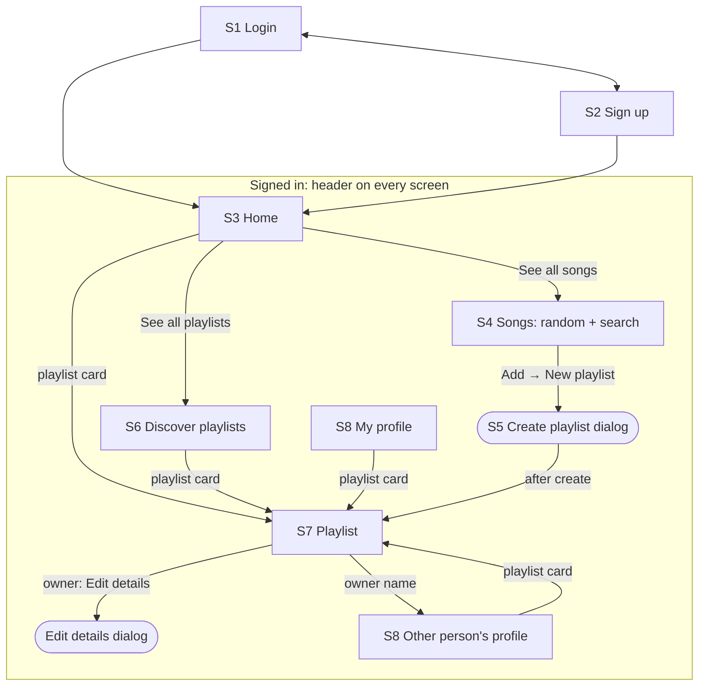

# UI Design

The first version (v1) of the web app for the music-db playlist platform. It's built on the API in [API-Design.md](API-Design.md). This file is the source of truth for the UI: what each screen shows, how it behaves, which API calls it makes, and which API changes it needs.

**Working name:** *Runlist*, a list of songs to run through. The name is a placeholder and appears only in the mockups.

**Status:** initial design, with the first round of decisions made (see the [Decision log](#decision-log)). The app will be built in **React**. The visual direction is **Proposal A, Sleeve**.

**Contents**

- [Related UI documents](#related-ui-documents)
- [Product in one paragraph](#product-in-one-paragraph)
- [Decision log](#decision-log)
- [Scope of v1](#scope-of-v1)
- [Product rules](#product-rules)
- [Vocabulary: UI words vs. API words](#vocabulary-ui-words-vs-api-words)
- [Information architecture](#information-architecture)
- [Navigation](#navigation)
- [Screens](#screens)
  - [S1 Login](#s1-login)
  - [S2 Sign up](#s2-sign-up)
  - [S3 Home](#s3-home)
  - [S4 Songs](#s4-songs)
  - [S5 Create playlist](#s5-create-playlist)
  - [S6 Discover playlists](#s6-discover-playlists)
  - [S7 Playlist](#s7-playlist)
  - [S8 Profile (me and others)](#s8-profile-me-and-others)
- [Shared patterns](#shared-patterns)
- [Mockups and visual proposals](#mockups-and-visual-proposals)
- [API changes the UI needs](#api-changes-the-ui-needs)
- [Implementation notes (React)](#implementation-notes-react)
- [Accessibility](#accessibility)
- [Responsive behavior](#responsive-behavior)
- [Future extensions](#future-extensions)
- [Open questions](#open-questions)

---

## Related UI documents

The UI docs follow a light Double Diamond process: **discover and define** (who it's for, what they need), then **develop and deliver** (flows, screens, visual system).

| File | Phase | What it holds |
|---|---|---|
| [ui/UX-Research.md](ui/UX-Research.md) | Discover / Define | Problem statement, personas, jobs to be done, user stories with acceptance criteria, assumptions to test. |
| [ui/User-Flows.md](ui/User-Flows.md) | Define / Develop | Flow diagrams for sign up, search and add a song, create and edit a playlist, favorite (with the 5-favorite limit and public/private) and share. |
| **UI-Design.md** (this file) | Develop | Decisions, information architecture, screen specs, low-fidelity wireframes, API mapping, gaps. |
| [ui/Design-System.md](ui/Design-System.md) | Develop / Deliver | Tokens, type, components and their states, copy guidelines. |
| [ui/mockups/index.html](ui/mockups/index.html) | Deliver | Clickable high-fidelity mockups of every v1 screen. Proposal A (chosen) and Proposal B (kept for reference). Open the file in a browser. |

---

## Product in one paragraph

The catalog holds an unlimited number of songs. You can **search** it or browse a random selection, and collect songs into **playlists** (up to 20 of your own, up to 20 songs each). Playlists are **private** by default. Each person keeps up to **5 favorites**, their own playlists or other people's, and the favorites are their **profile**: always public, shown A–Z. Favoriting one of your own playlists is how you make it public, so other people can open it, share it and favorite it. A playlist stays public while **anyone** has it as a favorite: if its owner takes it off their profile, it stays on the profiles of the people who favorited it. The app is for collecting and curating music. Playback isn't part of v1, because the database has no audio.

---

## Decision log

Decisions taken since the first draft. Each one updates the rules and screens below.

| ID | Date | Decision | Affects |
|---|---|---|---|
| D-01 | 2026-11-10 | Login uses the API's own login (`POST /auth/login`, `/auth/refresh`, `/auth/logout`) for now, not an external provider. | S1, S2 |
| D-02 | 2026-11-10 | Visual direction: **Proposal A, Sleeve**. Proposal B, Gig poster, stays in the mockups and the design system as a reference and is not developed further. | All screens, [Design-System.md](ui/Design-System.md) |
| D-03 | 2026-11-10 | Front-end stack: **React**. See [Implementation notes](#implementation-notes-react). | Implementation |
| D-04 | 2026-11-10 | Favorites are shown in **alphabetical order** by playlist name, on Home and on the profile. | S3, S8 |
| D-05 | 2026-11-10 | Favorites are **always public**: anyone who opens a profile sees all 5. | S8, BR-06 |
| D-06 | 2026-11-10 | New playlists are **private**. Favoriting is what makes a playlist public. (Refined by D-10.) | S5, S6, S7, BR-10, BR-12 |
| D-07 | 2026-11-10 | Favoriting a sixth playlist opens a dialog that asks which of your five to swap out. Confirmed as designed. | [Replace a favorite](#replace-a-favorite) |
| D-08 | 2026-11-10 | The Songs screen gets **search**: typing loads a list of matching songs. | S4 |
| D-09 | 2026-11-10 | The owner can **edit a playlist's details** (name and description) on the Playlist screen. | S7 |
| D-10 | 2026-11-10 | A playlist is **public while anyone has it as a favorite**, its owner or other people. When the owner unfavorites it, it leaves the owner's profile but stays public, and stays on the other people's profiles, while they keep it. Only when nobody has it does it become private. Nobody loses a favorite because of someone else's action. | BR-12, BR-13, S7, S8, [Replace a favorite](#replace-a-favorite), [Last favorite](#last-favorite), API-Design.md [Visibility follows favorites](API-Design.md#visibility-follows-favorites) |
| D-11 | 2026-11-10 | Authentication uses **JWT**: the API signs short-lived (15 min) JWT access tokens, sent as `Authorization: Bearer`, plus opaque refresh tokens. | S1, S2, API-Design.md [Tokens (JWT)](API-Design.md#tokens-jwt) |
| D-12 | 2026-11-10 | A playlist its owner unfavorited **stays in Discover and search** while anyone still has it as a favorite (answers Q-08). | S6, BR-07 |
| D-13 | 2026-11-10 | The owner **can't** make a playlist private while others have it as a favorite; only **deleting** it does that (answers Q-10). | S7, BR-12 |
| D-14 | 2026-11-11 | A playlist holds **at most 20 songs** (was 100). Seed playlists that already have more keep their songs, show their real count (for example "75 / 20") and are **Full**. | BR-03, S4, S5, S7, G-03, DB-Design.md [DB-04](DB-Design.md#db-04-track-limit-20-per-playlist) |

---

## Scope of v1

**In scope:** Login, Sign up, Home, Songs (random songs **and search**), Create playlist, Discover playlists, Playlist (with **Edit details** for the owner), Profile (mine and other people's). Removing a song, deleting a playlist and copying a public playlist's link are also in scope, because they are the way out of the two limits (20 songs, 20 playlists) and the way to share.

**Out of scope for v1** (see [Future extensions](#future-extensions)): searching playlists and people, playback, reordering songs, cover upload, share links for private playlists, collaborators, liked songs, following users or artists, artist and album pages, the activity feed, settings, and avatar upload.

---

## Product rules

These rules are new: the API doesn't enforce all of them yet (see [API changes the UI needs](#api-changes-the-ui-needs)). The UI shows each limit *before* the user reaches it, and the API is the final check.

| ID | Rule | How the UI shows it |
|---|---|---|
| BR-01 | The song catalog has no size limit. The UI shows a random sample of it, or the results of a search. | "Shuffle" gets a new sample; the search box finds anything. |
| BR-02 | A person owns **at most 20 playlists**. | A count such as "9 of 20 playlists" on Home and in the create dialog. At 20, "New playlist" is disabled and says why. |
| BR-03 | A playlist holds **at most 20 songs** (D-14). | A count such as "7 / 20" in the add menu and on the playlist. A full playlist is disabled in the add menu and labeled "Full". |
| BR-04 | A person has **at most 5 favorite playlists**, counting their own and other people's together. | "3 of 5" next to the Favorites heading. Favoriting a sixth opens [Replace a favorite](#replace-a-favorite) and never fails silently. |
| BR-05 | You can favorite your own playlists, and other people's **public** playlists. | Hearts appear only where favoriting is allowed. |
| BR-06 | A profile shows its owner's favorites **in alphabetical order** (D-04). Favorites are **always public** (D-05): everyone who opens the profile sees all of them. | Empty slots appear only on your own profile. |
| BR-07 | Playlist recommendations are random **public** playlists owned by other people that you haven't favorited. | – |
| BR-08 | Song recommendations are random songs from the catalog. | – |
| BR-09 | The **last used** playlist is the one you most recently added a song to. | It's the first item in the add menu. |
| BR-10 | New playlists are **private** (D-06). The create form asks only for a name and a description. | A note in the dialog: "Private: only you can see it. Favorite it to make it public." |
| BR-11 | In v1 a playlist doesn't hold the same song twice. The API allows duplicates, but the UI marks a song that's already there and doesn't add it again. | "✓ Added" in the add menu. |
| BR-12 | **A playlist is public while at least one person has it as a favorite, and private when nobody does** (D-06, D-10). Favoriting your own playlist makes it public and puts it on your profile. Unfavoriting it takes it off your profile; it becomes private only if nobody else has it. There's no separate visibility setting, and the owner can't make a playlist private while others have it: only deleting does that (D-13). | A badge on your playlist: "Public · on your profile", "Public · in 2 people's favorites" or "Private · only you". A toast says what changed. |
| BR-13 | Removing the **last** favorite of a playlist makes it private. If the person removing it isn't the owner, they can't open it again afterwards. | That person confirms first: see [Last favorite](#last-favorite). The owner never needs to confirm: they keep access. |
| BR-14 | Only public playlists can be shared. | "Copy link" is disabled on a private playlist and explains how to make it public. |
| BR-15 | Only the owner can edit a playlist's details: name (1–120 characters) and description (up to 2000). | "Edit details" on the owner's playlist page. |

---

## Vocabulary: UI words vs. API words

The UI uses the words people use. The API uses the database's words. Developers should keep this table in mind.

| The UI says | The API calls it | Note |
|---|---|---|
| Song | **Track** (`track_id`) | A playlist holds recordings (tracks), not compositions (songs). Users don't need that difference in v1, so the UI says "song". |
| Favorite / Unfavorite | **Follow / unfollow a playlist** (`PUT`/`DELETE /me/following/playlists/{id}`) | The same relationship with a limit of 5. See [G-01](#api-changes-the-ui-needs). |
| Favorites | `GET /me/following/playlists` | |
| Public / Private | `visibility` = `public` / `private` | Never set by the user directly. It's `public` while the playlist has at least one favorite (BR-12, [G-11](#api-changes-the-ui-needs)). `unlisted` isn't used in v1. |
| Your playlists | `GET /me/playlists` where `my_role = owner` | |
| Owner, "by Ana García" | `owner.display_name`, `owner.username` | |
| Search songs | `GET /search?q=…&types=track` | Needs more fields per result, see [G-12](#api-changes-the-ui-needs). |
| Edit details | `PATCH /playlists/{id}` with `name`, `description` | |
| Share link | `https://<app>/playlists/{id}` | Works only while the playlist is public. |

---

## Information architecture



**URLs** (React Router routes, see [Implementation notes](#implementation-notes-react)):

| Route | Screen | Signed in? |
|---|---|---|
| `/login` | S1 Login | no |
| `/signup` | S2 Sign up | no |
| `/` | S3 Home | yes |
| `/songs` | S4 Songs, random | yes |
| `/songs?q=come+together` | S4 Songs, search results. The query is in the URL so results can be bookmarked and Back works. | yes |
| `/discover` | S6 Discover playlists | yes |
| `/playlists/{id}` | S7 Playlist | no for **public** playlists: a shared link works for signed-out visitors, and actions prompt them to log in. A private playlist is "not found" to everyone except its owner. |
| `/u/{username}` | S8 Profile | no |
| `/me` | Redirects to `/u/{my username}` | yes |

S5 Create playlist and Edit details are dialogs, not routes. They open on top of the current screen.

---

## Navigation

One header on every signed-in screen. The **New playlist** button lives here, at the top of the page, so you can create a playlist from anywhere.

```
┌──────────────────────────────────────────────────────────────────────────────┐
│ ◉ Runlist    Home   Songs   Discover                  [ + New playlist ] (AG)│
└──────────────────────────────────────────────────────────────────────────────┘
                                                                            │
                                                         (AG) menu: My profile
                                                                    Log out
```

On a phone (under 640 px) the links move to a bottom tab bar (**Home · Songs · Discover · Me**), and the top bar keeps the logo and a **+** button.

---

## Screens

Each screen has: its **job**, a **low-fidelity wireframe**, its **content and behavior**, its **states**, and the **API calls** it makes. The clickable versions are in [ui/mockups/index.html](ui/mockups/index.html).

### S1 Login

**Job:** get a returning person into the app in one step.

```
┌──────────────────────────────────────┐
│               ◉ Runlist              │
│   Collect songs. Share playlists.    │
│                                      │
│  Username or email                   │
│  [ ana.garcia                     ]  │
│  Password                            │
│  [ ••••••••••                  👁 ]  │
│                                      │
│  [            Log in              ]  │
│                                      │
│  New here?  Create an account →      │
└──────────────────────────────────────┘
```

- **Behavior:** "Log in" stays enabled. Empty fields get an inline message when the form is submitted. Enter submits. The password field has a show/hide toggle.
- **States:** default · submitting (the button shows "Logging in…" and the form is locked) · wrong credentials ("That username and password don't match. Check them and try again.") · network error (a banner with "Try again").
- **After login:** go to the page the person was trying to reach, or to Home.
- **API (D-01, D-11):** `POST /auth/login` → `access_token` (a **JWT**) + `refresh_token`, then `GET /me`. The JWT goes in `Authorization: Bearer` on every request and lasts 15 minutes; refresh it in the background with `POST /auth/refresh`. "Log out" calls `POST /auth/logout`. These endpoints are in the implementation (REQUIREMENTS.md AUTH-06 to AUTH-08) and now in API-Design.md, [Authentication](API-Design.md#authentication-auth).
- **Errors:** `401 invalid_credentials` gives the message above. The same message is used for an unknown user and a wrong password, on purpose (AUTH-17).

### S2 Sign up

**Job:** create an account with as few fields as possible.

```
┌──────────────────────────────────────┐
│               ◉ Runlist              │
│        Create your account           │
│                                      │
│  Name                                │
│  [ Sofía López                    ]  │
│  Username                            │
│  [ sofia.lopez                    ]  │
│  3–30 characters: a–z, 0–9, . and _  │
│  You can't change it later.          │
│  Email                               │
│  [ sofia.lopez@example.com        ]  │
│  Password                            │
│  [ ••••••••                    👁 ]  │
│  At least 8 characters               │
│  Country (optional)                  │
│  [ Spain                        ▾ ]  │
│                                      │
│  [         Create account         ]  │
│  Already have an account?  Log in →  │
└──────────────────────────────────────┘
```

- **Behavior:** the username is suggested from the name (`Sofía López` → `sofia.lopez`: lower case, accents removed, spaces become dots), and the person can edit it. Fields are checked when they lose focus. After a successful sign-up the person is logged in and goes to Home.
- **Client checks** (match the API so most errors never reach it): name 1–80 characters; username `^[a-z0-9_.]{3,30}$`; a valid email of at most 254 characters; password 8–72 characters.
- **States:** default · field errors · submitting · username taken ("That username is taken. Try sofia.lopez2.") · email taken ("An account with this email exists. Log in instead?" with a link).
- **API:** `GET /reference/countries` for the dropdown (cache it), then `POST /users` with `username`, `display_name`, `email`, `password` and `country_code`, then `POST /auth/login`.
- **Errors:** `409 username_taken` and `409 email_taken` go on their fields. `422 weak_password` and `422 password_too_long` go on the password field. Any other `422` uses `details[].field` to choose the field.

### S3 Home

**Job:** a short summary of everything, with a way into each screen. Each section shows a few items and a "See all" link.

```
┌──────────────────────────────────────────────────────────────────────────────┐
│ ◉ Runlist    Home   Songs   Discover                  [ + New playlist ] (AG)│
├──────────────────────────────────────────────────────────────────────────────┤
│ Good evening, Ana                                                            │
│                                                                              │
│ Your favorites  (public, A–Z)                                       3 of 5   │
│ ┌──────┐ ┌──────┐ ┌──────┐ ┌ ─ ─ ─ ┐ ┌ ─ ─ ─ ┐                              │
│ │cover │ │cover │ │cover │   empty     empty                                 │
│ └──────┘ └──────┘ └──────┘ └ ─ ─ ─ ┘ └ ─ ─ ─ ┘                              │
│ Boleros  Night    Road Trip                                                  │
│ by Diego by Ben   by you                                                     │
│                                                                              │
│ Songs for you                                     [ ⟳ Shuffle ]  See all →   │
│  Here Comes the Sun   The Beatles · Abbey Road          3:05   [ + Add ]     │
│  One More Time        Daft Punk · Discovery             5:20   [ + Add ]     │
│  Money                Pink Floyd · The Dark Side…       6:22   [ + Add ]     │
│  (6 rows)                                                                    │
│                                                                              │
│ Playlists to discover                                             See all →  │
│ ┌──────┐ ┌──────┐ ┌──────┐ ┌──────┐                                          │
│ │cover♡│ │cover♡│ │cover♡│ │cover♡│                                          │
│ └──────┘ └──────┘ └──────┘ └──────┘                                          │
│                                                                              │
│ Your other playlists  🔒 mostly private                     9 of 20          │
│ ┌──────┐ ┌──────┐ ┌──────┐ ┌──────┐ ┌──────┐ ┌──────┐ …                      │
└──────────────────────────────────────────────────────────────────────────────┘
```

| Section | Shows | Each item | Empty state |
|---|---|---|---|
| Your favorites | Up to 5 favorites **A–Z by name** (D-04), plus dashed empty slots up to 5. | Cover, name, "by you" or "by {owner}", filled heart. | A new user sees 5 empty slots: "Favorite up to 5 playlists. They're public and appear on your profile." |
| Songs for you | 6 random songs, with Shuffle and "See all → Songs". | Title, artist · album, duration, **Add**. | – (the catalog is never empty) |
| Playlists to discover | 4 random public playlists by other people, with "See all → Discover". | Cover, name, owner, song count, heart. | "You've favorited everything we found. Check back later." |
| Your other playlists | Every playlist you own that isn't a favorite, newest first, with a count "n of 20". Most are **private**. One that other people have as a favorite stays public (BR-12) and says so on its card ("Public · 2 favorites"). The section says under its heading: "Private unless someone has them as a favorite. Favorite one to make it public." | Cover, name, song count, heart, and "Public" when it is. | "No other playlists. Make one with New playlist." with a button. |

- **States:** loading (each section loads on its own, with gray placeholder cards) · a section that fails shows "Couldn't load this. Try again." in its own place, and the rest of the page still works.
- **API (run in parallel):** `GET /me/following/playlists?sort=name` · `GET /tracks/random?limit=6` *(G-05)* · `GET /playlists/random?limit=4` *(G-06)* · `GET /me/playlists?role=owner` (minus favorites, filtered in the client). The Add menu uses the same playlist list as [S4](#s4-songs).

### S4 Songs

**Job:** find songs, by searching or by browsing a random selection, and add them to playlists quickly.

```
┌──────────────────────────────────────────────────────────────────────────────┐
│ header                                                                       │
├──────────────────────────────────────────────────────────────────────────────┤
│ Songs                                                                        │
│ A random handful from the catalog. Search, or shuffle for more.              │
│ ┌────────────────────────────────────────────────────────────┐               │
│ │ 🔍  Search songs, artists or albums                     ✕  │ [ ⟳ Shuffle ] │
│ └────────────────────────────────────────────────────────────┘               │
│                                                                              │
│  #  Title                 Artist          Album                Time          │
│  1  Come Together         The Beatles     Abbey Road           4:20 [ + Add ]│
│  2  Digital Love          Daft Punk       Discovery            4:58 [ + Add ]│
│  3  El Triste             José José       El Triste            4:21 [ + Add ]│
│                                                    ┌───────────────────────┐ │
│                                                    │ Add to playlist       │ │
│                                                    │ LAST USED             │ │
│                                                    │  Road Trip       7/20 │ │
│                                                    │ ALL PLAYLISTS (A–Z)   │ │
│                                                    │  Boleros      ✓ Added │ │
│                                                    │  Night Drive    12/20 │ │
│                                                    │  Road Trip       7/20 │ │
│                                                    │  Workout         Full │ │
│                                                    │ ───────────────────── │ │
│                                                    │  + New playlist       │ │
│                                                    └───────────────────────┘ │
│  4  Time                  Pink Floyd      The Dark Side…       6:53 [ + Add ]│
│ … 20 rows                                                                    │
│                         [ Load 20 more ]                                     │
└──────────────────────────────────────────────────────────────────────────────┘
```

With a search (D-08):

```
│ ┌────────────────────────────────────────────────────────────┐               │
│ │ 🔍  daft punk                                           ✕  │ [ ⟳ Shuffle ] │
│ └────────────────────────────────────────────────────────────┘               │
│ 9 songs match "daft punk"                                                    │
│  #  Title                 Artist          Album                Time          │
│  1  One More Time         Daft Punk       Discovery            5:20 [ + Add ]│
│  2  Digital Love          Daft Punk       Discovery            4:58 [ + Add ]│
│  …                                                                           │
│                         [ Load more results ]                                │
```

- **Search (D-08):**
  - The search box sits at the top of the screen. It searches song titles, artists and albums. The search ignores case and accents: `jose` finds *José José*.
  - Results load **as you type**, starting at 2 characters, 300 ms after the last keystroke. Enter searches at once. Each new search cancels the one before it, so results never arrive out of order.
  - The results replace the random list, under a line such as "9 songs match "daft punk"". Results use the same song rows, so **+ Add** works the same way.
  - **✕** or Esc clears the search and brings back the random list as it was. **Shuffle** clears the search and gets new random songs.
  - The query goes in the URL (`/songs?q=daft+punk`), so Back and bookmarks work.
  - 20 results at a time, with "Load more results".
- **Search states:** typing (fewer than 2 characters: the random list stays) · searching (placeholder rows under the box; the previous results stay dimmed) · results · no results ("No songs match "bowie". Check the spelling, or try an artist or album name.") · error ("Search isn't working right now. Try again.").
- **The add menu** (see [Add to playlist](#add-to-playlist)):
  1. **Last used:** the playlist you most recently added a song to (BR-09). It also appears in the A–Z list below, so the list stays complete and predictable.
  2. **All playlists (A–Z):** every playlist you own, sorted by name with a locale-aware, accent-insensitive comparison.
  3. **+ New playlist:** opens S5, and after the playlist is created, adds the song to it.
- **Each item** shows its count "n/20". A **full** playlist is disabled and labeled "Full". A playlist that **already has the song** shows "✓ Added" and is disabled.
- **After adding:** the menu closes and a toast says "Added to Road Trip" with **Undo** for 5 seconds. Undo removes the entry it just added.
- **Load more:** gets 20 more random songs and leaves out songs already on screen. Shuffle replaces the whole list.
- **No playlists yet:** the menu shows only "You don't have a playlist yet" and **+ New playlist**.
- **API:** random: `GET /tracks/random?limit=20&exclude=…` *(G-05)*. Search: `GET /search?q=daft+punk&types=track&limit=20&offset=0` *(needs G-12)*. Add menu: `GET /me/playlists?role=owner&sort=name` with `last_added_at` *(G-07)* and `contains_track` *(G-08)*. Add: `POST /playlists/{id}/tracks` `{ "track_ids": [id] }` with `If-Match: "<version>"`. Undo: `DELETE /playlists/{id}/tracks/{position}` with the new version.
- **Errors:** `412` (someone else changed the playlist): get the playlist's version again and retry once without telling the user, because appending is safe to retry. `422 playlist_full` *(G-03)*: mark the playlist "Full" and show "Road Trip is full (20 songs). Remove a song or pick another playlist."

### S5 Create playlist

**Job:** make a playlist with a name in a few seconds. It opens from **New playlist** in the header, or from **+ New playlist** in the add menu.

```
┌─────────────────────────────────────────┐
│ New playlist                         ✕  │
│                                         │
│ Name                                    │
│ [ Sunday Morning                     ]  │
│                                 14/120  │
│ Description (optional)                  │
│ [ Coffee and vinyl.                  ]  │
│ [                                    ]  │
│                                17/2000  │
│                                         │
│ 🔒 Private: only you can see it.        │
│ Favorite it to make it public.          │
│ You have 9 of 20 playlists.             │
│                                         │
│              [ Cancel ]  [ Create ]     │
└─────────────────────────────────────────┘
```

- **Behavior:** the name field has focus when the dialog opens. "Create" is disabled until the name has a character that isn't a space. Esc and ✕ close the dialog, and if something was typed, they ask "Discard this playlist?" first. Created from the add menu, the playlist gets the song right away (`track_ids: [id]`) and the person stays where they were, with the toast "Created Sunday Morning and added Come Together". Created from the header, the person goes to the new, empty playlist (S7).
- **Visibility (D-06):** every new playlist is private. The dialog doesn't offer a choice; it says how to make the playlist public.
- **At the limit (20 of 20):** the header button is disabled, with the tooltip "You have 20 playlists, the most allowed. Delete one to make a new one."
- **API:** `POST /playlists` `{ name, description, visibility: "private", track_ids? }`. Errors: `422` on the name (empty or too long), and `422 playlist_limit_reached` *(G-04)*.

### S6 Discover playlists

**Job:** find other people's playlists worth favoriting.

```
┌──────────────────────────────────────────────────────────────────────────────┐
│ header                                                                       │
├──────────────────────────────────────────────────────────────────────────────┤
│ Discover playlists                                            [ ⟳ Shuffle ]  │
│ Public playlists from other people.          Your favorites: 3 of 5          │
│                                                                              │
│ ┌────────────┐ ┌────────────┐ ┌────────────┐ ┌────────────┐                 │
│ │   cover    │ │   cover    │ │   cover    │ │   cover    │                 │
│ │          ♡ │ │          ♥ │ │          ♡ │ │          ♡ │                 │
│ └────────────┘ └────────────┘ └────────────┘ └────────────┘                 │
│ Mexican 80s    Space Rock     Coding Focus   Tokyo Commute                  │
│ by Diego Ramos by Ben Carter  by Kenji W.    by Kenji W.                    │
│ 31 songs       14 songs       58 songs       14 songs                       │
│ … 12 cards                                                                   │
│                         [ Load more ]                                        │
└──────────────────────────────────────────────────────────────────────────────┘
```

- **What's here:** public playlists only, which means playlists that someone keeps as a favorite (BR-12), including ones their owner unfavorited while others still have them (D-12). Each person has at most 5, so this is the best of what people have picked.
- **Behavior:** tap the card to open the playlist (S7). Tap the heart to favorite or unfavorite it right there. The heart has its own label for screen readers ("Favorite Night Drive"). A playlist you just favorited stays on screen, with a filled heart, until the next Shuffle.
- **At 5 favorites:** the heart opens [Replace a favorite](#replace-a-favorite).
- **API:** `GET /playlists/random?limit=12` *(G-06)*; `PUT /me/following/playlists/{id}` to favorite, `DELETE` to unfavorite. Errors: `422 favorite_limit_reached` *(G-01)* opens Replace a favorite (the client's count can be out of date if another tab changed it). `404` (the owner made it private a moment ago) removes the card and shows "That playlist is no longer public."

### S7 Playlist

**Job:** see what's in a playlist, who made it, and act on it.

```
┌──────────────────────────────────────────────────────────────────────────────┐
│ header                                                                       │
├──────────────────────────────────────────────────────────────────────────────┤
│ ┌──────────┐  PUBLIC PLAYLIST · ON YOUR PROFILE      ← owner only            │
│ │          │  Road Trip                          ← name in big type          │
│ │  cover   │  (AG) Ana García                    ← owner, links to profile   │
│ │          │  Songs for the drive. Add yours!                                │
│ └──────────┘  7 songs · 35 min · 3 favorites                                 │
│               [ ♥ Favorited ] [ ⧉ Copy link ] [ ✎ Edit details ] [ ⋯ ]      │
│                                                                              │
│  #  Title                 Artist          Album                Time          │
│  1  Here Comes the Sun    The Beatles     Abbey Road           3:05    ⋯     │
│  2  Come Together         The Beatles     Abbey Road           4:20    ⋯     │
│  3  One More Time         Daft Punk       Discovery            5:20    ⋯     │
│  …                                                                           │
│  ─────────────────────────────────────────                                   │
│  7 / 20 songs                                     (owner only)               │
└──────────────────────────────────────────────────────────────────────────────┘
```

- **Header:** name in display type (the biggest text in the app), then the owner with their avatar (links to S8), the description, and meta: number of songs · total time · number of favorites.
- **Visibility badge (owner only):** "Public playlist · on your profile", "Public playlist · in 2 people's favorites" (the owner unfavorited it, others still have it), or "Private playlist · only you". Visitors only ever see public playlists, so they see just "Playlist".
- **Actions:**
  - **Favorite / Favorited** (everyone, including the owner). For the owner, this button also switches the playlist between public and private (BR-12):
    - Favoriting your own playlist: toast "Road Trip is now public and on your profile".
    - Unfavoriting your own playlist when nobody else has it: toast "Road Trip is now private", with Undo.
    - Unfavoriting your own playlist when other people have it: toast "Road Trip left your profile. It stays public while 2 people have it as a favorite.", with Undo. No confirmation: nobody loses anything.
    - Unfavoriting someone else's playlist when you're its **last** favorite: [Last favorite](#last-favorite) asks first.
  - **Copy link** (public playlists only, BR-14) copies `https://<app>/playlists/{id}`, and the toast says "Link copied". On a private playlist the button is disabled with the hint "Private playlists can't be shared. Favorite it to make it public."
  - **Edit details** (owner only, D-09) opens the [Edit details](#edit-details) dialog.
  - **⋯ menu** (owner only): **Edit details** again, and **Delete playlist**, which asks "Delete Road Trip? Its 7 songs are removed from it. This can't be undone."
- **Song rows:** number, title, artist, album, time. The **⋯** on a row (owner only) has **Remove from playlist**, with an Undo toast. People who don't own the playlist see no menu on rows in v1.
- **Owner only:** the capacity line "7 / 20 songs" at the end of the list.
- **States:** loading · empty for the owner ("No songs yet." with a button "Find songs" that goes to S4) · empty for others ("This playlist has no songs yet.") · not found, which covers a playlist that doesn't exist, has been deleted, or is private and not yours ("We can't find this playlist. It may have been deleted or made private.") · signed out (a public playlist is readable; Favorite asks you to log in).
- **API:** `GET /playlists/{id}` (gives `visibility`, `my_access.is_following` and `version`) and `GET /playlists/{id}/tracks?limit=100` in parallel. Edit details: `PATCH /playlists/{id}` `{ name, description }` with `If-Match`. Remove: `DELETE /playlists/{id}/tracks/{position}` with `If-Match`. Delete: `DELETE /playlists/{id}`. Favorite and unfavorite as in S6; the API changes the visibility *(G-11)*. `404` gives the not-found state. `412` on remove or edit: reload and show "This playlist changed. We've reloaded it."

### S8 Profile (me and others)

**Job:** show who someone is through their five favorite playlists.

```
┌──────────────────────────────────────────────────────────────────────────────┐
│ header                                                                       │
├──────────────────────────────────────────────────────────────────────────────┤
│        ┌────────┐                                                            │
│        │ photo  │   Ana García                  ← name in big type           │
│        │  (AG)  │   @ana.garcia · Mexico                                     │
│        └────────┘   Road trips and Sunday boleros.                           │
│                                                                              │
│ Favorite playlists  (A–Z)                                          3 of 5    │
│ ┌──────┐ ┌──────┐ ┌──────┐ ┌ ─ ─ ─ ┐ ┌ ─ ─ ─ ┐                              │
│ │cover │ │cover │ │cover │   empty     empty      ← empty slots: own profile │
│ └──────┘ └──────┘ └──────┘ └ ─ ─ ─ ┘ └ ─ ─ ─ ┘      only                     │
│ Boleros  Night    Road Trip                                                  │
│ by Diego by Ben   by you                                                     │
└──────────────────────────────────────────────────────────────────────────────┘
```

- **Content:** profile picture (`avatar_url`, otherwise initials on a color made from the username), display name in display type, `@username` and country, bio, then the favorites **A–Z by name** (D-04).
- **Everyone sees all of them** (D-05): favorites are always public, so the profile looks the same to its owner and to visitors, except for the controls below.
- **My profile:** the count "3 of 5"; empty slots that link to Discover ("Find a playlist"); a heart on each card to unfavorite it. Unfavoriting one of my own takes it off my profile; it becomes private only if nobody else has it (BR-12).
- **Someone else's profile:** their favorites, with no empty slots. Each card has a heart so you can favorite it too. If they have none: "Ben hasn't picked any favorites yet."
- **Not in v1:** edit profile, followers and following. The "Edit profile" button appears in the mockup as disabled, to keep its place.
- **API:** `GET /users/{username}` and `GET /users/{username}/favorites?sort=name` *(G-02)*. My own profile uses `GET /me` and `GET /me/following/playlists?sort=name`. `404` gives "There's no one called @username here."

---

## Shared patterns

### Add to playlist

This is the most common action in the app, so it gets the most care.

- A **menu button** ("+ Add", with `aria-haspopup="menu"`), not a native `<select>`: the menu has groups, counts and disabled rows, and a `<select>` can't show those well.
- Order: **Last used**, then **All playlists A–Z**, then **+ New playlist**. With 8 or more playlists, a "Filter playlists" field appears at the top of the menu and has focus when the menu opens.
- Keyboard: Enter or Space opens the menu; arrow keys move; Enter picks; Esc closes and puts focus back on the button.
- On a phone the menu opens as a **bottom sheet**, with the same content.
- **Optimistic:** the count goes up and the toast appears right away. If the request fails, the count goes back and the toast becomes the error.

### Replace a favorite

What happens when you favorite a sixth playlist (D-07). It never fails silently, and the person never has to go somewhere else first.

```
┌─────────────────────────────────────────┐
│ Your favorites are full                 │
│ You can have 5. Pick one to replace     │
│ with Night Drive.                       │
│                                         │
│  (cover) Boleros para mamá by Diego  ○  │
│  (cover) Coding Focus      by Kenji  ●  │
│  (cover) Mexican 80s       by Diego  ○  │
│  (cover) Road Trip         by you ·  ○  │
│                            stays public │
│                            · 2 others   │
│  (cover) Sunday Morning    by you ·  ○  │
│                            becomes      │
│                            private      │
│                                         │
│           [ Cancel ]  [ Replace ]       │
└─────────────────────────────────────────┘
```

- The list is A–Z, like the favorites themselves.
- Each row says what happens to that playlist if you replace it (BR-12):
  - "stays public · 2 others have it" when other people also have it as a favorite;
  - "becomes private" when you're its last favorite and it's yours;
  - "becomes private · you can't open it again" when you're its last favorite and it's someone else's.
- API: `DELETE /me/following/playlists/{old}` then `PUT /me/following/playlists/{new}`. A single swap endpoint would make this atomic (see G-01).

### Last favorite

Shown when you unfavorite (or replace) **someone else's** playlist and you're the only person who has it as a favorite (BR-13). Removing it makes it private, and you won't be able to open it again. In every other case, unfavoriting just happens, with an Undo toast.

```
┌─────────────────────────────────────────┐
│ Remove Vinyl Sundays from favorites?    │
│ You're the only one who has it, so it   │
│ becomes private and only Ben Carter     │
│ will be able to open it.                │
│                                         │
│        [ Cancel ]  [ Remove ]           │
└─────────────────────────────────────────┘
```

The client knows it's the last favorite when the playlist's `follower_count` is 1 and the caller is one of its followers. The `DELETE` response confirms it with `"visibility": "private"`.

### Edit details

The owner's dialog for name and description (D-09). It's the same form as [S5](#s5-create-playlist), filled in with the current values.

```
┌─────────────────────────────────────────┐
│ Edit details                         ✕  │
│ Name                                    │
│ [ Road Trip                          ]  │
│                                   9/120 │
│ Description (optional)                  │
│ [ Songs for the drive. Add yours!    ]  │
│                                 31/2000 │
│ Public while it's one of your           │
│ favorites, private otherwise.           │
│              [ Cancel ]  [ Save ]       │
└─────────────────────────────────────────┘
```

- "Save" is disabled until something changes and the name isn't blank. Closing with changes asks "Discard your changes?".
- After saving, the dialog closes, the page shows the new name, and the toast says "Saved".
- There's no visibility field: visibility follows the favorites (BR-12). The dialog says "Public while anyone has it as a favorite, private otherwise."
- API: `PATCH /playlists/{id}` with only the changed fields and `If-Match`. `412` means someone else changed the playlist: reload the values in the dialog and say "This playlist changed while you were editing. Check the details and save again."

### Toasts

Bottom center (bottom of the screen on phones), one at a time, 5 seconds, with at most one action (Undo or Try again). Announced with `role="status"`.

### Playlist covers

v1 has no uploaded covers. Each cover is generated from the playlist's ID: a two-color pattern from a fixed palette, plus the first letter of the name. The same playlist always gets the same cover. `cover_url`, when a playlist has one, takes priority.

### Loading, empty, error

- **Loading:** gray placeholder shapes the size of the real content (no spinners in lists).
- **Empty:** says what goes here, and gives one action to fill it.
- **Error:** says what failed and how to fix it, with "Try again". Errors stay inside their section.
- **Signed out on a public page:** actions that need an account open a small dialog: "Log in to favorite playlists" with **Log in** and **Sign up**.

---

## Mockups and visual proposals

[ui/mockups/index.html](ui/mockups/index.html) is a clickable, self-contained page (no build step or install) with every screen above, their main states, desktop and phone frames, and both visual proposals.

**Decision (D-02): Proposal A, Sleeve, is the chosen direction.** Proposal B stays in the mockups for reference and isn't developed further.

| | Proposal A: **Sleeve** ✅ chosen | Proposal B: **Gig poster** (reference only) |
|---|---|---|
| Idea | Record sleeves on a shelf. Covers lead, the layout is calm, the palette is light. | A concert poster in a dark room. Big condensed type, a dense list, amber light. |
| Navigation | Top bar on desktop, bottom tabs on a phone. | Sidebar on desktop, bottom tabs on a phone. |
| Home | Horizontal shelves of covers. | Stacked sections, with lists in place of cards. |
| Theme | Light, cool paper white with cobalt. | Dark slate with amber. |
| Type | Archivo, wide, for display; Figtree for text. | Bebas Neue for display; Manrope for text. |
| Best for | People who browse visually; the phone. | Power users with large libraries; the desktop. |

Why A: it puts the covers first, so a profile of five favorites reads at a glance, and it's the simpler layout on a phone. B's dense song list is still worth borrowing for the Songs screen if libraries grow.

In the mockups you can try: searching songs, the add menu (last used first, then A–Z, full and already-added rows), favoriting up to the limit of 5 and the Replace dialog, making your own playlist public or private through its heart, creating a playlist from the header, editing a playlist's details, removing a song with Undo, and the sign-up checks.

---

## API changes the UI needs

**All of these are now specified in [API-Design.md](API-Design.md)**: see its [Changes for the web UI](API-Design.md#changes-for-the-web-ui) table, and the endpoints marked **(UI)** in its endpoint index. The database side (triggers, functions, views, indexes, data migration) is in [DB-Design.md](DB-Design.md), changes DB-00 to DB-10. This table keeps the UI's reasons and points to each one.

| ID | Need | Now in API-Design.md | Needed by |
|---|---|---|---|
| G-01 | **5-favorite limit** (BR-04), and an atomic swap for the Replace dialog. | Trigger `playlist_follow_limit` → `422 favorite_limit_reached`; `PUT /me/following/playlists/{id}` with `{ "replaces": old_id }`. [Favorites](API-Design.md#favorites) | S3, S6, S7, S8 |
| G-01b | **Favoriting your own playlist** (BR-05). | Allowed; no self-check on `playlist_follow`. Still to confirm against the schema. [Favorites](API-Design.md#favorites) | S7, S8 |
| G-02 | **Another person's favorites**, A–Z. | `GET /users/{username}/favorites?sort=name`; `?sort=name` on `GET /me/following/playlists`. [`GET /users/{username}/favorites`](API-Design.md#get-usersusernamefavorites) | S3, S8 |
| G-03 | **20-song limit** (BR-03, D-14). | Trigger `playlist_track_limit` ([DB-04](DB-Design.md#db-04-track-limit-20-per-playlist)) → `422 playlist_full`; at most 20 `track_ids` per request. [Limits](API-Design.md#limits) | S4, S5, S7 |
| G-04 | **20-playlist limit** (BR-02), and the counts for the UI. | Trigger `playlist_owner_limit` → `422 playlist_limit_reached`; `owned_playlist_count`, `favorite_count` on `GET /me`. [Limits](API-Design.md#limits) | S3, S5 |
| G-05 | **Random songs.** | `GET /tracks/random?limit=&exclude=`, picked by `random_tracks()` (DB-06). [Random picks](API-Design.md#random-picks) | S3, S4 |
| G-06 | **Random playlists from other people.** | `GET /playlists/random?limit=&exclude=`. [Random picks](API-Design.md#random-picks) | S3, S6 |
| G-07 | **Last used playlist** (BR-09). | `last_added_at` and `?sort=last_added` on `GET /me/playlists`. [`GET /me/playlists`](API-Design.md#get-meplaylists) | S4 |
| G-08 | **"Already added"** (BR-11). | `?contains_track=` → `contains_track` on `GET /me/playlists`. | S4 |
| G-09 | **Role filter on my playlists.** | `?role=owner` on `GET /me/playlists`. | S3, S4 |
| G-10 | **New playlists are private** (BR-10). | `POST /playlists` always creates `private`; sending `visibility` → `422 visibility_follows_favorites`. | S5 |
| G-11 | **Visibility follows favorites** (BR-12, BR-13, D-10). | Trigger `playlist_visibility_from_favorites`: `public` while any `playlist_follow` row exists, `private` otherwise. `PATCH` no longer takes `visibility`. Follow and unfollow return `200` with the new `visibility` and `follower_count`. [Visibility follows favorites](API-Design.md#visibility-follows-favorites) | S6, S7, S8 |
| G-12 | **Song search with full song rows** (D-08). | `GET /tracks?q=&limit=&offset=` with `search_tracks(q, limit, offset)`, over title, artist and album. [`GET /tracks?q=`](API-Design.md#get-tracksq--song-search) | S4 |

Smaller notes:
- **Words:** the API keeps "follow". The UI says "favorite". If "follow a playlist" will mean something else later (for example, a feed without the limit of 5), favorites would need their own table. Today one relationship is enough.
- **Login (D-01):** API-Design.md now describes the API's own login in [Authentication](API-Design.md#authentication-auth).
- **REQUIREMENTS.md** doesn't list these changes yet. It should get new IDs for them when the implementation picks them up.
- **Avatar:** `avatar_url` only takes a URL, and there's no upload. v1 shows initials when it's empty.
- **CORS:** the web app's origin has to be allowed (REQUIREMENTS.md SEC-05).

---

## Implementation notes (React)

The stack is React (D-03). It's built in [ui-react-music](https://github.com/oggmont/ui-react-music) (local clone `../ui-react-music`). These are suggestions for the first build, not decisions: the libraries can change without changing anything else in this document.

| Concern | Suggestion | Why |
|---|---|---|
| Language and build | TypeScript, Vite | Types for the API's JSON; a fast dev server and a plain static build. |
| Routes | React Router, with the routes in [Information architecture](#information-architecture) | Search state lives in the URL (`/songs?q=`). |
| Server data | TanStack Query | Caching, cancelling stale searches, and optimistic updates with rollback (add, favorite, remove) are built in. |
| API client | Generated from the API's OpenAPI document (springdoc, REQUIREMENTS.md §21) | The types follow the API with no hand-written copies. |
| Auth (JWT, D-11) | JWT access token in memory, refresh token handled as API-Design.md [Tokens (JWT)](API-Design.md#tokens-jwt) describes; one place (an API-client wrapper) adds `Authorization: Bearer`, refreshes before `exp`, and retries a `401` once after a refresh. Don't trust the JWT's `role` claim for anything but display. | Tokens never land in `localStorage`. |
| Styling | CSS variables taken from [Design-System.md](ui/Design-System.md) (Proposal A values), CSS modules or a similar scoped approach | The tokens are already defined as CSS variables in the mockups. |
| Accessible pieces | A headless library for the menu, dialog and toast (for example Radix UI or React Aria) | Focus trapping, keyboard support and ARIA roles are hard to get right by hand. |

Component map, from the screens above:

```
<App>
├── <AuthLayout>             S1 <LoginPage>, S2 <SignupPage>
└── <AppLayout>              <Header> (+ <NewPlaylistButton>), <TabBar> on phones
    ├── <HomePage>           <FavoritesShelf>, <SongList>, <PlaylistShelf>, <PlaylistGrid>
    ├── <SongsPage>          <SongSearch>, <SongList>
    ├── <DiscoverPage>       <PlaylistGrid>
    ├── <PlaylistPage>       <PlaylistHeader>, <VisibilityBadge>, <SongList>, <CapacityMeter>
    └── <ProfilePage>        <ProfileHeader>, <FavoritesShelf>
Shared: <PlaylistCard>, <FavoriteHeart>, <SongRow>, <AddToPlaylistMenu>,
        <PlaylistFormDialog> (create and edit), <ReplaceFavoriteDialog>,
        <LastFavoriteDialog>, <ConfirmDialog>, <Toast>, <Cover>, <Avatar>
```

`<FavoriteHeart>` is the only place that favorites and unfavorites. It handles the limit of 5, the Replace dialog, the Last favorite dialog and the visibility toasts, so every screen behaves the same.

---

## Accessibility

Target: **WCAG 2.2 AA**.

- Contrast: 4.5:1 for text, 3:1 for icons, borders of inputs and focus rings. A full playlist is labeled with the word "Full", not only with gray. Public and private are words in the badge, not only an icon.
- Everything works with the keyboard, with a visible focus ring. Dialogs trap focus and give it back when they close. Esc closes menus and dialogs, and clears the search.
- The search box has a visible label for screen readers ("Search songs"), and the result count ("9 songs match…") is announced with `role="status"`.
- Hearts are buttons with `aria-pressed` and a label that names the playlist. Counts like "3 of 5" are real text, not only an image.
- Toasts use `role="status"`. Form errors are linked to their fields with `aria-describedby` and announced when the form is submitted.
- Touch targets are at least 44 × 44 px on a phone. Animations stop when `prefers-reduced-motion` is set.
- Text can grow to 200% without breaking the layout. Names wrap rather than being cut, except in cards, where they stop at two lines and the full name is in the title attribute.

---

## Responsive behavior

| Width | Layout |
|---|---|
| under 640 px (phone) | Bottom tabs, **+** in the top bar. Shelves scroll sideways. The Songs list becomes two-line rows (title, then artist · album). The search box takes the full width. The add menu becomes a bottom sheet. Dialogs take the full screen. |
| 640–1023 px (tablet) | Top bar. Grids have 3 columns. |
| 1024 px and over (desktop) | Top bar. Grids have 4–6 columns. The content area is at most 1200 px wide. |

---

## Future extensions

Planned after v1, roughly in priority order. Each one already has an endpoint in API-Design.md unless it says otherwise.

1. **Search playlists and people**, and one search box in the header (`GET /search` with `types=playlist,user`). v1 has song search on the Songs screen only.
2. **Reorder songs** by dragging (`POST /playlists/{id}/tracks/move`), and **upload a cover** (`cover_url` exists; uploads need file storage).
3. **Share links for private playlists** (`unlisted` + `share_token`, `/playlists/shared/{token}`), so a private playlist can be sent without being on your profile.
4. **Collaborators:** invite editors, who then see the playlist in their add menu (`/playlists/{id}/collaborators`).
5. **Edit profile:** name, bio, country, avatar (`PATCH /me`). Avatar *upload* needs file storage, which the system doesn't have.
6. **Liked songs** (`/me/tracks`), and the heart on song rows (`/me/tracks/contains`).
7. **Artist and album pages** from the catalog (`/artists/{slug}`, `/albums/{id}`).
8. **Follow people and an activity feed** (`/me/following/users`, `/me/feed`).
9. **Copy a playlist** to make your own version (`POST /playlists/{id}/copy`).
10. **Dark theme** for Proposal A. B's palette can be a starting point.
11. **Playback or previews:** needs audio sources, which the database doesn't have.

---

## Open questions

| ID | Question | Status |
|---|---|---|
| Q-01 | Login: the API's own `/auth/login`, or an external provider? | **Decided (D-01):** the API's own login, for now. |
| Q-02 | Does the limit of 20 count only owned playlists, or collaborations too? | Open. Default: owned only. |
| Q-03 | Should the add menu list playlists where I'm an editor? | Open. Default: not in v1; it arrives with collaborators. |
| Q-04 | Proposal A or B, or a mix? | **Decided (D-02):** A, Sleeve. B kept for reference. |
| Q-05 | Duplicates: block them (BR-11) or allow them as the API does? | Open. Default: block them in the UI. |
| Q-06 | Should Home's "Your other playlists" be sorted by newest or by last used? | Open. Default: newest. |
| Q-07 | Front-end stack? | **Decided (D-03):** React. |
| Q-08 | Should a playlist its owner unfavorited still appear in Discover? | **Decided (D-12):** yes, while anyone has it as a favorite. |
| Q-09 | Deleting a playlist that other people have as a favorite removes it from their favorites too. Is one confirmation enough? | Open. Default: one confirmation that says so ("Delete Road Trip? 2 people have it in their favorites and will lose it."). |
| Q-10 | Can the owner make a playlist private while others have it as a favorite? | **Decided (D-13):** no; only deleting it removes it for everyone. |
