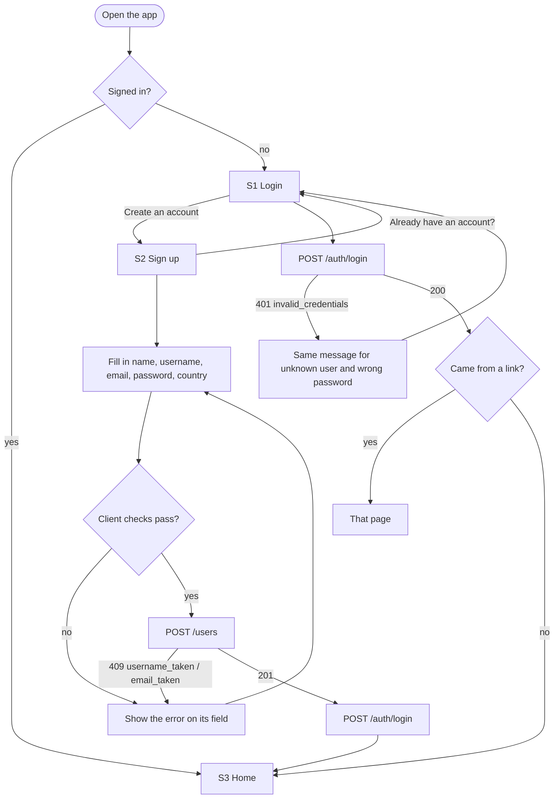
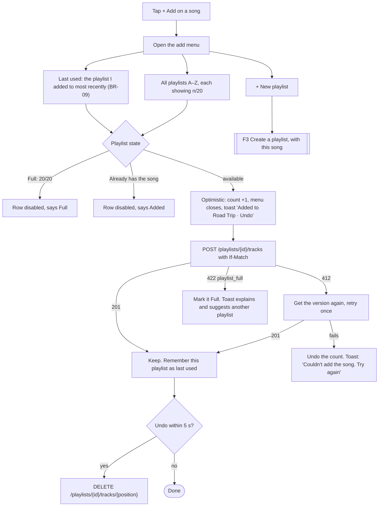
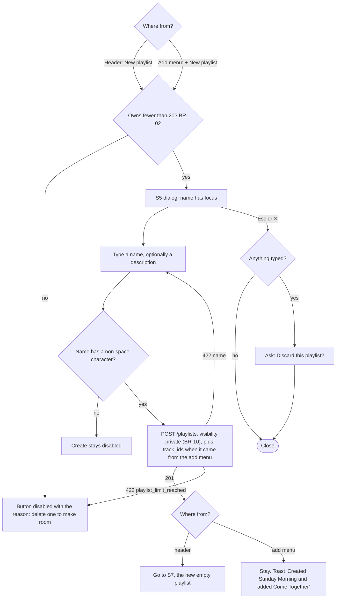
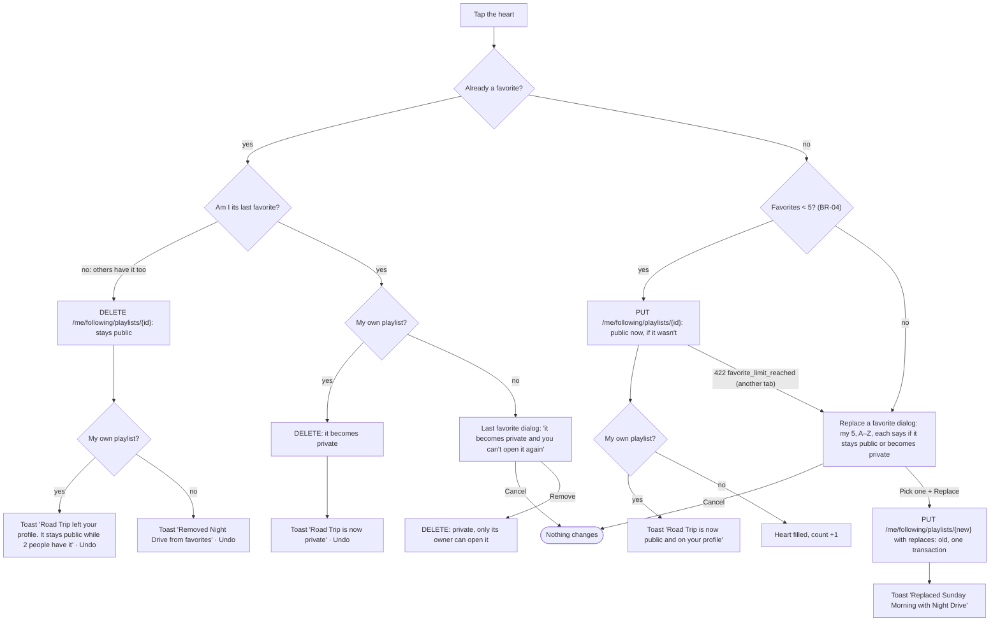
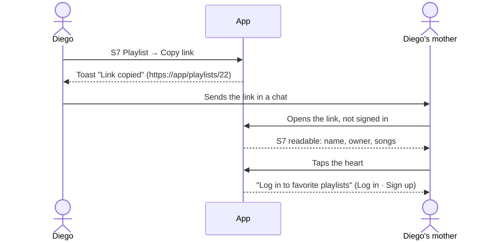
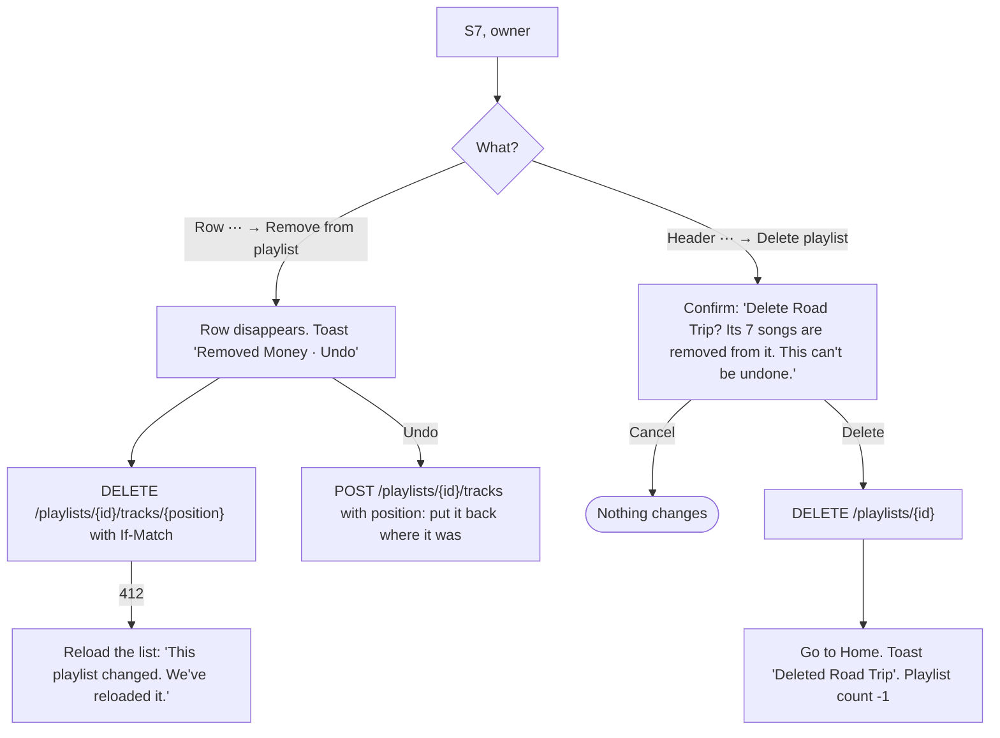
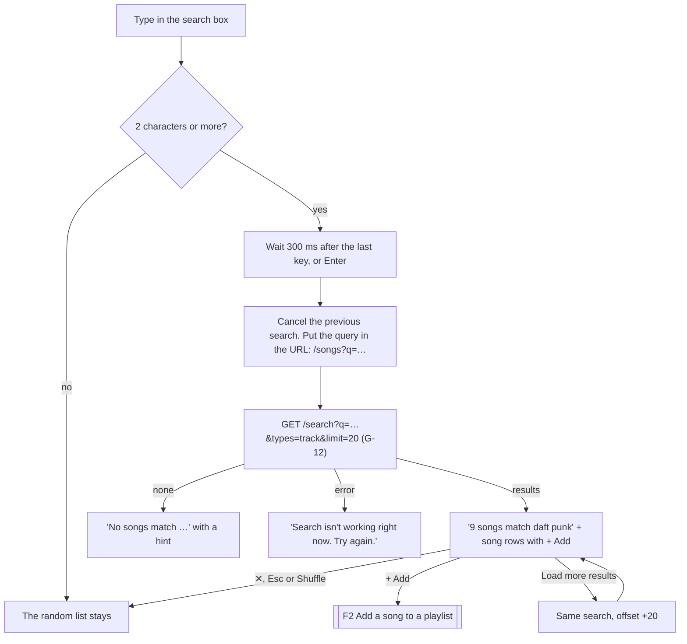
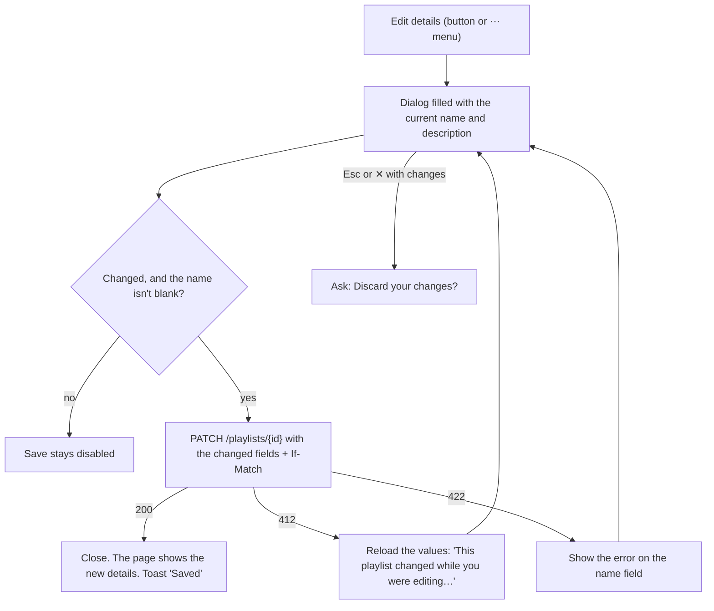

# User Flows

The main v1 flows, step by step, including what happens when a limit is hit or a request fails. Screen IDs (S1–S8) and rule IDs (BR-xx) refer to [UI-Design.md](../UI-Design.md). GitHub renders the diagrams.

**Contents**

- [F1 Sign up and log in](#f1-sign-up-and-log-in)
- [F2 Add a song to a playlist](#f2-add-a-song-to-a-playlist)
- [F3 Create a playlist](#f3-create-a-playlist)
- [F4 Favorite a playlist (limit of 5)](#f4-favorite-a-playlist-limit-of-5)
- [F5 Share a playlist](#f5-share-a-playlist)
- [F6 Remove a song or delete a playlist](#f6-remove-a-song-or-delete-a-playlist)
- [F7 Search for a song](#f7-search-for-a-song)
- [F8 Edit a playlist's details](#f8-edit-a-playlists-details)

---

## F1 Sign up and log in

The access token lives 15 minutes. The app refreshes it in the background (`POST /auth/refresh`) and sends the person to Login, keeping the page they were on, only when the refresh fails.

---

## F2 Add a song to a playlist

The flow that matters most. It starts on Home ("Songs for you"), on S4 Songs (random songs), or on S4 search results ([F7](#f7-search-for-a-song)).

---

## F3 Create a playlist

---

## F4 Favorite a playlist (limit of 5)

Starts from a heart on S3 Home, S6 Discover, S7 Playlist or S8 Profile. Favorites also decide visibility: a playlist is public while **anyone** has it as a favorite, and private when nobody does (BR-12, D-10).

Own playlists and other people's count toward the same 5. Favorites appear A–Z on Home ("Your favorites") and on the profile, and everyone who opens the profile sees all of them (BR-06). Nobody loses a favorite because of what someone else does: only deleting a playlist removes it from other people's favorites.

---

## F5 Share a playlist

Only public playlists (ones that someone has as a favorite) can be shared, so the plain URL works for anyone. On a private playlist, Copy link is disabled with the hint "Private playlists can't be shared. Favorite it to make it public." Share links for private playlists (`unlisted` + `share_token`) are a future extension.

---

## F6 Remove a song or delete a playlist

If the deleted playlist was a favorite, it leaves the favorites too (the database cascade removes its follows), so a slot opens. That includes other people's favorites. When other people have it, the confirmation says so: "Delete Road Trip? 2 people have it in their favorites." (Q-09.)

---

## F7 Search for a song

On S4 Songs (D-08).

---

## F8 Edit a playlist's details

On S7, owner only (D-09).

